<div align="center">




<br/>


</div>

---

### 👨‍💻 Sobre mí

Soy **Iván Martos**, desarrollador de software con interés en crear aplicaciones bien estructuradas, mantenibles y agradables de usar. Me gusta entender cómo funcionan las cosas por dentro, escribir código claro y mejorar un poco cada día.

```kotlin
data class Developer(
    val name: String = "Iván Martos",
    val role: String = "Software Developer",
    val languages: List<String> = listOf("Java", "Kotlin", "Python", "SQL"),
    val databases: List<String> = listOf("Oracle", "MySQL"),
    val learning: List<String> = listOf("Java a fondo", "Kotlin", "Python"),
    val motto: String = "Hazlo funcionar, hazlo bien, hazlo limpio."
)
```

---

### 🛠️ Stack tecnológico

<div align="center">

| | |
|:--|:--|
| **Lenguajes** |    |
| **Bases de datos** |   |
| **Herramientas** |   |

</div>

---

### 📊 Actividad en GitHub

<div align="center">
  
</div>

<br/>

<div align="center">
  
</div>
---


---

### 🎯 En lo que estoy

- ☕ Afianzando **Java** como lenguaje principal
- 🟣 Ampliando conocimientos de **Kotlin** y **Python**
- 🗄️ Trabajando con bases de datos **Oracle** y **MySQL**
- 🤝 Abierto a nuevas oportunidades y a colaborar en proyectos

---

### 💡 Principios con los que trabajo

> **Claridad** antes que ingenio · **Simplicidad** antes que complejidad · **Constancia** antes que prisa

<br/>

### 📬 Contacto

<div align="center">
  <a href="https://www.linkedin.com/in/ivan-martos-5b840343b/"></a>
  <a href="mailto:ivan.martosv@gmail.com"></a>
</div>

<br/>

<br/>

<div align="center">
  
</div>

<div align="center">
  
</div>
